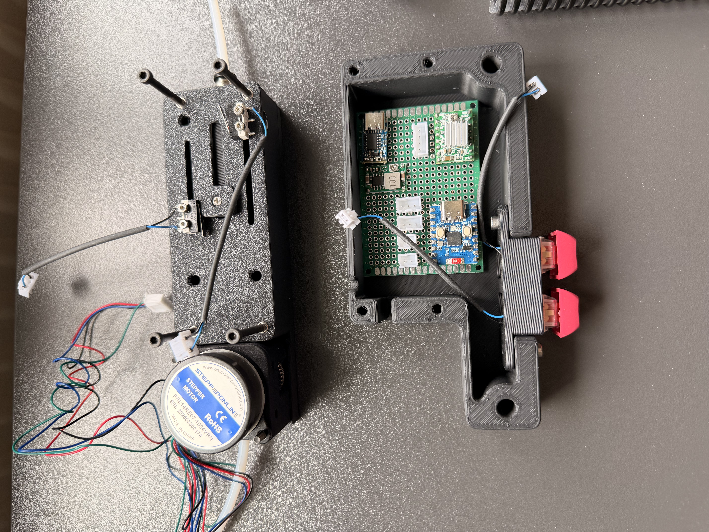
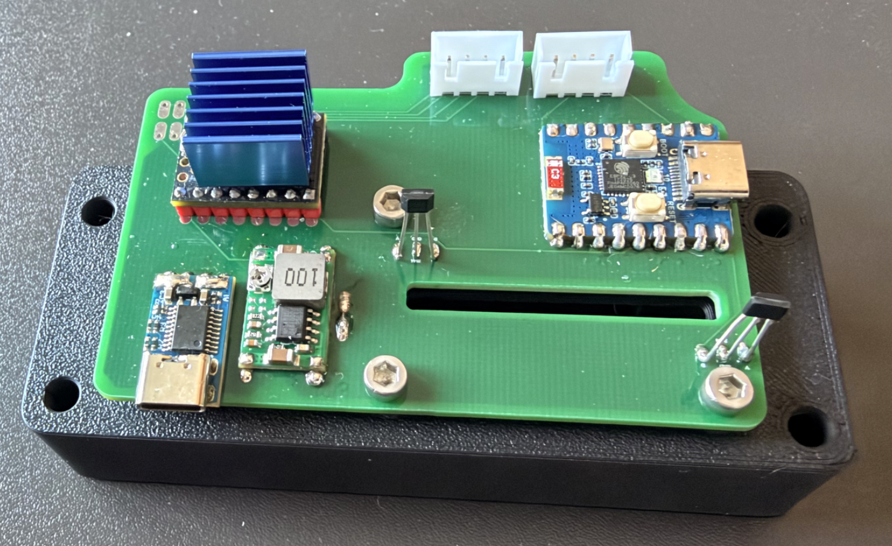

# Active Filament Buffer / Extruder Assist

This project is an automated filament delivery system (buffer) for 3D printers. It monitors the filament tension and presence and actively pushes material towards the printer, which reduces the load on the printer's own extruder — especially useful for large setups or high-speed printing.

The entire system is fully assembled and soldered onto a permanent perfboard.

UPDATE: The entire system is now fully assembled and soldered onto a custom PCB

## 🚀 The Engineering Behind It

Unlike passive buffers, this is an active system: an ESP32 and a stepper motor feed filament exactly when the printer needs it, and stop the moment the buffer is full.

### Key Software Features:
* **Custom FB Architecture:** No Arduino sketch spaghetti — the whole process lives in one self-contained, non-blocking "function block" (`FB_Buffer`) in an IEC-61131-3 / PLC-inspired style, with its own step-chain. `main.cpp` only instantiates it and calls it once per scan cycle. Same pattern as my other projects.
* **`StepperDriverAbsolut`:** A thin wrapper around `AccelStepper` that takes targets in millimetres of filament instead of raw steps. Positioning is non-blocking, so the state machine keeps reading the endstops and buttons while the motor runs.
* **PLC-Style Utilities:** Sensor debouncing and edge detection go through my own `Ton` (On-Delay) and `EdgePosNeg` classes instead of `delay()` or ad-hoc flags.
* **Endstop Logic:** Two endstops tell the buffer when it is empty and needs material and when it is full, to prevent grinding or snapping the filament.
* **Microstep-Scaled Motion:** Speed and acceleration are defined as 1/1-step base values and multiplied by the active microstepping factor (currently 1/8).
* **Modular Architecture:** Hardware configuration (`app_config.h`), PLC-style utilities and the process function block are cleanly separated.

## 🛠️ Features

* **Auto-Feeding:** Detects an empty buffer via `PIN_ENDSTOP_NEG` and feeds in bursts of 25 mm.
* **Manual Override:** Physical "Jog Forward" and "Jog Backward" buttons move the filament as long as they are held (10 ms debounce) for easy loading and unloading.
* **Safety Interlock:** The positive endstop (`PIN_ENDSTOP_POS`) instantly halts automatic feeding to prevent mechanical damage.
* **Self-Zeroing:** After a completed feed or jog move, the position reference is set back to zero once the buttons and the endstop are released, so every feed starts from a clean reference.
* **Status Monitoring:** Real-time serial debugging shows sensor edges and state machine steps, e.g. `FB_Buffer - Aktueller Schritt: 20`.

## 📁 Project Structure

* **src/main.cpp:** Instantiates the function block and calls it each scan cycle.
* **src/app_config.h:** Pin mapping, configuration flags and hardware constants.
* **src/POUs/01_Buffer/:** The `FB_Buffer` function block — the core state machine for automated feeding and manual jogging.
* **lib/StepperDriverAbsolut/:** Non-blocking positioning wrapper around `AccelStepper`, with targets in millimetres.
* **lib/Ton, EdgePosNeg/:** PLC-style timing and edge-detection utilities for input debouncing.
* **cad/:** CAD files of the mechanical parts.

## 🔧 Technical Stack

* **Controller:** ESP32-C3 (ESP32-C3-DevKitM-1)
* **Motor Control:** STEP/DIR stepper driver, 1/8 microstepping
* **Inputs:** 2 endstops (buffer empty / buffer full), 2 jog buttons
* **Framework:** Arduino / PlatformIO
* **Library:** AccelStepper
* **Language:** C++ (Object-Oriented, PLC/IEC-61131-3-inspired)
* **Hardware:** Custom PCB
